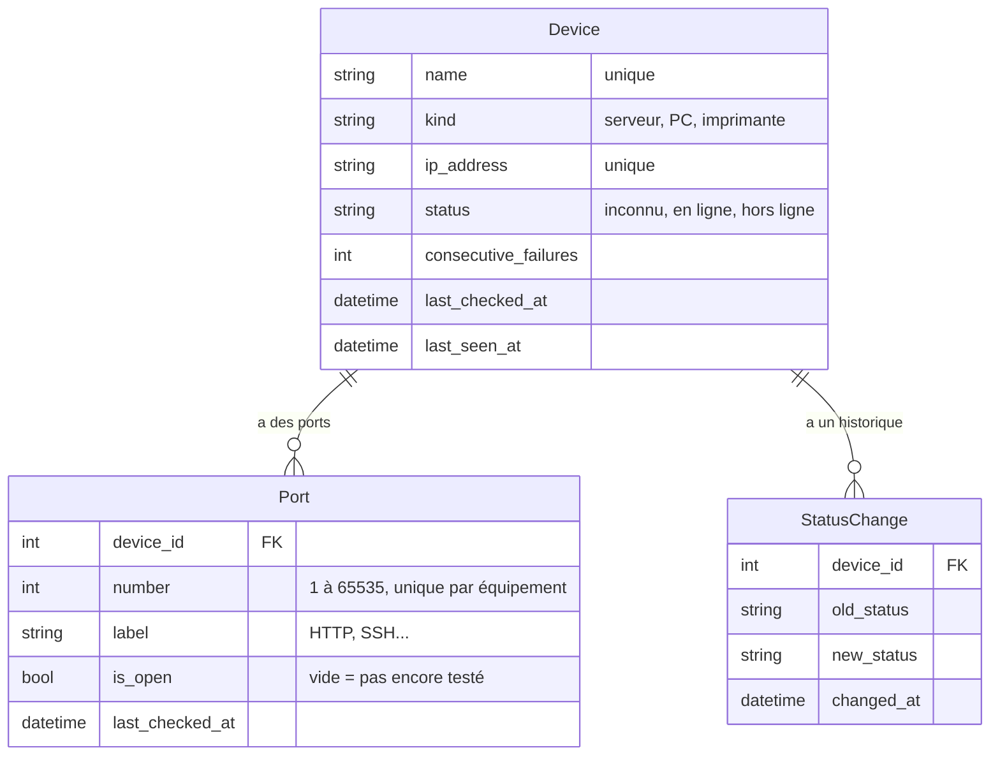

# supervision-reseau

Application web de supervision réseau : elle vérifie en continu des serveurs, postes et imprimantes, et affiche leur état en temps réel sur un tableau de bord.

Projet Python réalisé à Télécom SudParis par Alban ROBERT et Zakari HADJERES.

## Lancer le projet

Prérequis : Docker (Linux ou macOS).

```bash
git clone https://github.com/Alban091/supervision-reseau.git
cd supervision-reseau
docker compose up -d
```

L'application est ensuite disponible sur http://localhost:8080.

Pour tout arrêter : `docker compose down`.

## Compte par défaut

`admin` / `projetinfo1A`, créé automatiquement au premier lancement.

## Architecture

- `db` : base PostgreSQL 16
- `web` : application Django servie par Gunicorn
- `nginx` : reverse proxy sur le port 8080, qui sert aussi les fichiers statiques et les médias

Au démarrage, le conteneur `web` applique les migrations, copie les fichiers statiques et crée le compte admin s'il n'existe pas.

## Tests

```bash
docker compose exec web python manage.py test
```

## Roadmap

- [x] Projet Django et Docker (PostgreSQL, Gunicorn, Nginx)
- [ ] Parc de test Docker
- [x] Modèles et administration
- [ ] Supervision ping et TCP
- [ ] Tableau de bord en temps réel
- [ ] Équipements qui parlent (lot 1)

## Modèle de données

Trois modèles, dans `monitoring/models.py` :

- **Device** : un équipement du parc (serveur, PC ou imprimante), avec son nom et son adresse IP. Son état et ses dates de contrôle sont mis à jour par la boucle de supervision.
- **Port** : un port TCP à tester sur un équipement, par exemple 80 pour un serveur web, 22 pour SSH ou 9100 pour une imprimante.
- **StatusChange** : l'historique, avec une ligne à chaque changement d'état d'un équipement.


